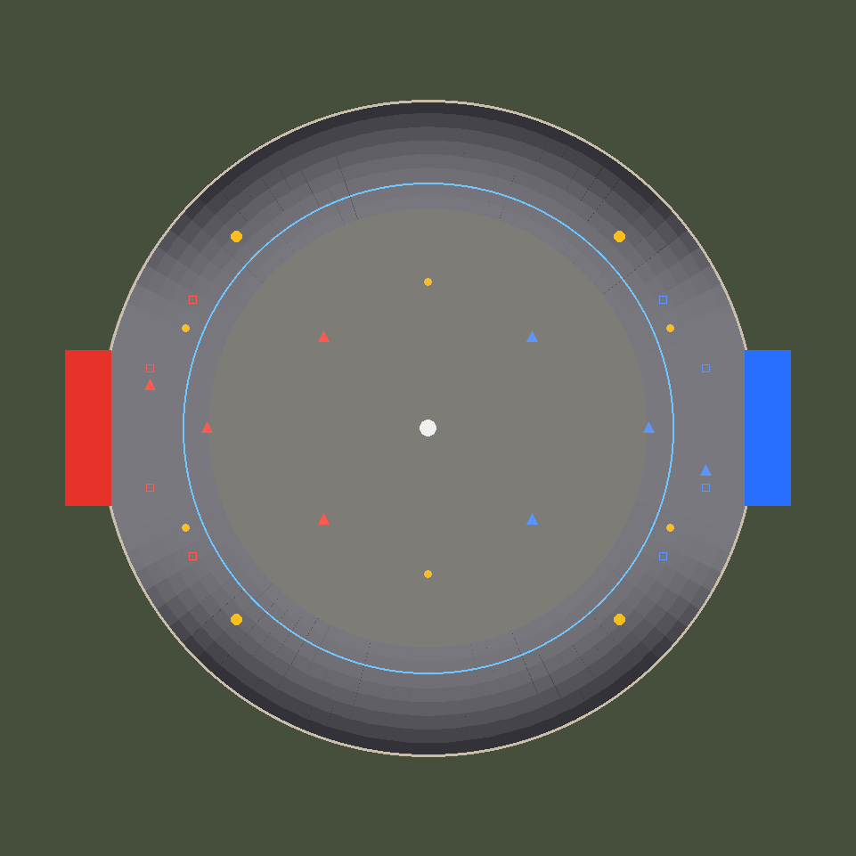

# Cooling Tower (q3r_coolingtower)

Autoball-Arena für 4 gegen 4 im trockenen Wasserbecken eines stillgelegten
Kühlturms. Rund statt rechteckig, Steilkurve statt Bande, Licht und Wetter fallen
nur durch die Öffnung oben auf die Mitte. Erzeugt von
`tools/maptools/make_coolingtower.py`. Konzept: Dokument „Cooling Tower – Autoball-Arena“.

Stand: **Stufe 0 (Testbox) und Stufe 1 (Rohbau)**. Graue Betontexturen, noch
keine Landschaft draußen, keine Dampffahnen, keine Feinarbeit am Licht.



## Aufbau

- **Spielfeld:** Kreis mit Radius 2304 (Ø 4608), Anstoßpunkt (0, 0). Flach bis
  r 1536, danach die Steilkurve mit Kreisbogenprofil bis 42° an der Wand (z 295).
  Die Kurve hat an den Seiten volle Höhe und läuft zu den Toren aus: flach bis
  ±20° um die Torachse, volle Höhe ab ±50°. Gebaut aus 1178 Dreiecksprismen
  (96 Segmente × 8 Ringe, je zwei), alle Detail.
- **Tore:** 1088 × 320, 320 tief, in flachen Portalwänden (±15° um die
  Torachse), Torlinie bei x = ±2225. Pfosten und Netze wie in Sundown, dahinter
  ein Torhaus aus Beton. Rot im Westen, Blau im Osten.
- **Wand:** Betonsockel bis zur Kante der Kurve, darauf Stahlgitter bis z 640
  (fest für Ball und Autos, durchsichtig, wirft Schatten), Ringbalken bis z 704,
  dahinter 48 Betonstützen.
- **Schale:** Hyperboloid aus 64 × 10 Segmenten, r 2304 bei z 704, Taille
  r 1664 bei z 2560, Öffnung r 1721 bei z 3072. Sie neigt sich nach innen und
  wirft hohe Bälle zurück.
- **Deckel:** Ein Sky-Brush schließt die Öffnung bei z 3072. Bullet nimmt jeden
  soliden Welt-Brush als Kollision, also prallt der Ball dort ab
  („Schornsteinschuss“, kein Aus). Für das Wetter ist er Himmel: Regen und Schnee
  starten unter Sky-Flächen, und q3map2 nimmt die Sonne von dort. Es gibt keine
  `autoball_reset`-Zonen; die eingebaute Rettung bleibt als Netz.
- **Anzeigetafel:** über der Mitte bei z 1200 (`rally_scoreboard` + Modell).
- **Licht:** Sonne hoch (65°) aus +y, also quer zum Feld, beide Hälften gleich.
  Dazu Himmelslicht durch Öffnung und Gitter, wenig warmes Füll-Licht und die
  Teamfarben in den Portalen.
- **Wetter:** Regen oder Schnee, 35 %, mit Wind. Es trifft nur die Mitte unter der
  Öffnung; der Ring bleibt trocken.

## Spielelemente

| Element | Wo |
|---|---|
| Ball (`autoball_ball`) | Anstoßpunkt (0, 0) |
| Anstoß (`team_CTF_*player`) | je 4, punktsymmetrisch |
| Respawn (`team_CTF_*spawn`) | je 4 in der eigenen Torbucht |
| NOS groß (5000 ms, alle 10 s) | 4 auf der Kurve bei 45°, 135°, 225°, 315°, r 1900 |
| NOS klein (1500 ms, alle 4 s) | Mittellinie y = ±1024, Ecken der Torbuchten (±1700, ±700) |
| Tore (`autoball_goal`) | ein Ballradius hinter der Torlinie bis zum Netz |

Die TV-Kamera (`cg_autoball.c`) sucht von der Feldmitte (z 310) seitlich die Wand.
Sie findet das Gitter bei r 2304, steht 260 davor über der Kurve und rechnet ihre
Höhe bis unter die Schale (etwa z 1000).

## Stufe 0: Testbox (q3r_coolingtower_test)

`python tools/maptools/make_coolingtower.py --test` schreibt eine Halle mit drei
geraden Kurvenstücken (25°, 35°, 42°, je 768 Lauf wie in der Arena): auf der
Nordseite (+y) aus Brushes, auf der Südseite (−y) als Patches. Farben: grün 25°,
gelb 35°, rot 42°. Dazu Ball und zwei kleine Tore.

```text
devmap q3r_coolingtower_test      (Spieltyp Autoball)
ball_kick 0 1800 0                (Ball gegen die Nordkurven)
ball_kick 0 -1800 0               (gegen die Südkurven)
```

Zu prüfen: Tragen die Autos 42°? Läuft der Ball auf den Brush-Kurven so glatt wie
auf den Patches? Die Arena nutzt Brushes; der Winkel ist `BANK_DEG` im Generator.

## Bauen

```text
python tools/maptools/make_coolingtower.py
python tools/maptools/make_coolingtower.py --test
q3map2 -game quake3 -fs_basegame baseq3r -fs_basepath <repo> -meta -custinfoparms <map>
q3map2 -game quake3 -fs_basegame baseq3r -fs_basepath <repo> -vis -saveprt <map>
q3map2 -game quake3 -fs_basegame baseq3r -fs_basepath <repo> -light -custinfoparms -fast -shade -filter -super 2 -bounce 1 <map>
bspc -forcesidesvisible -optimize -bsp2aas <bsp>
```

Der Generator schreibt beide Maps, `scripts/q3r_coolingtower.shader` und `.arena`,
die Texturen in `textures/q3r_coolingtower/` sowie `coolingtower_layout.png` und
`validation.json` hier. Nur der Boden außen und das Himmelsgehäuse sind
strukturell, `_blocksize 0` hält Vis bei einem Cluster (im Turm sieht man ohnehin
alles). `shaderlist.txt` muss `q3r_coolingtower` und `q3r_sundown` (Tore) enthalten.
