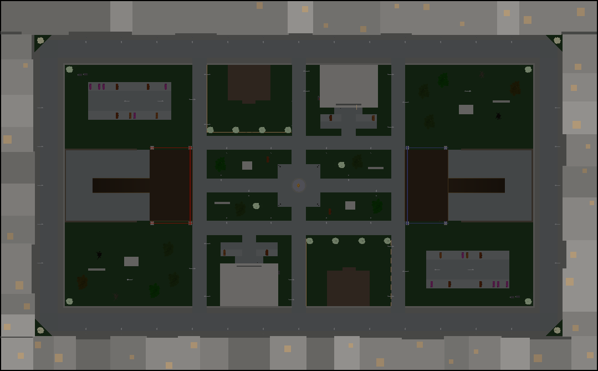

# Trophy Square (q3r_ctf_04)

Capture the Flag für zwei Teams auf einem Stadtplatz bei Nacht. Die Map gab es schon
als handgebaute Karte ohne Titel (rote Basis im Westen, blaue im Osten, der Pokal-Brunnen
in der Mitte, eine Autowerkstatt im Nordosten und ein Wohnhaus im Nordwesten, die
Südhälfte leer). `tools/maptools/rework_ctf04.py` baut daraus die fertige Map.
Quelle ist die alte Karte unter `tools/maptools/src/q3r_ctf_04_orig.map`; sie bleibt
unverändert, das Skript schreibt `baseq3r/maps/q3r_ctf_04.map` und
`scripts/q3r_ctf_04.arena` jedes Mal neu.



## Was das Skript ändert

- **Fairness:** Die Map ist jetzt punktsymmetrisch zum Pokal (x, y → −x, −y). Die
  Basen waren es schon. Die Werkstatt (BFG, Heckwaffen, Gesundheit) steht als Kopie im
  Südwesten, das Wohnhaus mit Garten im Südosten. Jedes Team hat damit eine Werkstatt
  mit BFG auf seiner Seite. Die Texturen werden genau mitgedreht (Maßstab und Drehung
  angepasst, das Skript prüft es), Schilder bleiben lesbar.
- **Ringstraße:** Die Welt ist auf jeder Seite 1152 Units größer. Um das alte Feld
  läuft eine Ringstraße mit Mittellinie, Gehwegen und Straßenlaternen; sie gehört zum
  Spielfeld. Die drei Nord-Süd-Straßen münden auf beiden Seiten in den Ring, er ist ein
  Flankenweg von Basis zu Basis. Zwischen Feld und Ring steht eine 48 Units hohe
  Betonbarriere, offen an den Straßenmündungen; hinter den Basen ist sie rot-weiß und
  geschlossen (kein Hintereingang zur Flagge). In den Ecken des Felds und des Rings
  liegen dreieckige Pflanzbeete, damit sich kein Auto in einer Ecke festfährt.
- **Stadt rundherum:** Hinter dem Ring ein geschlossener Ring aus Häusern mit
  Fassadentexturen (`q3r_building`), verschieden hoch, mit Dachaufbauten. Vor den
  Fassaden eine unsichtbare, feste Wand bis zum Himmel.
- **Licht:** Natriumdampf-Straßenlaternen (`docs/lanterns.md`) an den Straßen, am
  Ring und auf dem Parkplatz, Laternenpfähle an den Ecken des Platzes.
- **Deckung:** In den vier Blöcken um den Platz Eichen, Pflanzkübel mit Baum, niedrige
  Mauern, ein Kiosk und ein geparktes Auto. In den äußeren Ecken neben den Basen auf
  jeder Seite ein Parkplatz (Autos, Container) und ein kleiner Park (Bäume, Mauer,
  Kiosk). Zwischen allen Hindernissen bleiben mindestens rund 150 Units frei.
- **Kollision:** Bäume, Laternen und Automodelle haben einen festen, unsichtbaren Hull
  (`textures/q3r_ctf_04/propclip`), ebenso die Bäume der alten Map, die nur
  `common/full_clip` hatten: `full_clip` ist nur Spieler-Clip, die Fahrphysik (Bullet)
  nimmt aber nur feste Brushes. Die niedrigen Clips der Hebebühnen in der Werkstatt
  bleiben Spieler-Clip wie im Original; fest gemacht, blieben Bots zwischen den
  Bühnen hängen.
- **Flaggenpads:** Die Seiten nutzten eine fehlende Textur (`kilt_texpack02`), jetzt
  `evil5_ctf/ctf_crete_red` und `ctf_crete_blue`.
- Titel „Trophy Square“ in der Map und in der Arena-Datei.

## Pickups (paarweise gedreht)

| Pickup | Wo |
|---|---|
| BFG + 2 × Munition, Öl, Rauch, Mine, Flammenwerfer (Heck), große und kleine Gesundheit | Werkstatt (Nordost / Südwest) |
| Schrotflinte, Granatwerfer, Flammenwerfer, Railgun mit Munition | Basisdach |
| grüne, gelbe und rote Rüstung | Basisdach |
| Gesundheit | Block am Platz (Nordost / Südwest) |
| Granaten | Block am Platz (Nordwest / Südost) |
| große Gesundheit, Railgun-Munition | Parkplatz (Nordwest / Südost) |
| große Gesundheit, Schrot-Munition | Park (Nordost / Südwest) |

## Bauen

```text
python3 tools/maptools/rework_ctf04.py
q3map2 -game quake3 -fs_basegame baseq3r -fs_basepath <repo> -meta -custinfoparms -keeplights maps/q3r_ctf_04.map
q3map2 -game quake3 -fs_basegame baseq3r -fs_basepath <repo> -vis -saveprt maps/q3r_ctf_04.map
q3map2 -game quake3 -fs_basegame baseq3r -fs_basepath <repo> -light -custinfoparms -fast -super 2 -filter -bounce 8 maps/q3r_ctf_04.map
python3 tools/maptools/inject_lights.py baseq3r/maps/q3r_ctf_04.map
bspc -forcesidesvisible -optimize -bsp2aas maps/q3r_ctf_04.bsp
```

`inject_lights.py` schreibt die Lampen mit den Zielen der beiden Strahler in der
Werkstatt in die BSP (Lampenschatten im OpenGL2-Renderer). Danach die AAS bauen oder
ihre Prüfsumme anpassen.

Das Modell `models/mapobjects/spotlamp1/spotlamp1.md3` (die Strahler über der
Werkstatt) fehlte im Repo, die Map ließ sich deshalb nicht mehr bauen. Es ist aus der
alten BSP zurückgeholt (`tools/maptools/extract_model_from_bsp.py`).
