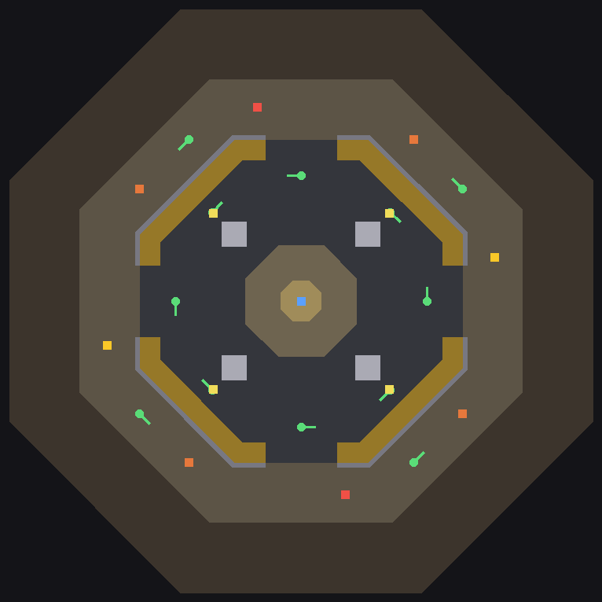

# Underground Battle Arena (q3r_david5)

Autoarena tief unter der Stadt für Deathmatch, Team Deathmatch, Derby und Last Car
Standing. Überarbeitung der Map von |CE: gleiches Konzept (achteckige Arena, Publikum
ringsum, Raketenwerfer für alle beim Spawn, Plasma als Preis), neu gebaut mit einem
echten Layout. Erzeugt von `tools/maptools/make_david5.py` (Python 3 + Pillow).



## Vorher

Ein leeres, flaches Achteck (2.048 Units), alle 8 Startpunkte am Rand mit Blick zur
Mitte, Plasma und Treibstoff in der Mitte, keine Gesundheit, keine Rüstung, keine
Deckung. Vier Tore an den Wänden waren Attrappen, die Wände 830 Units hoch (die
Tribünen lagen außerhalb der Fahrerkamera), das Licht sehr schwach.

## Aufbau

Spiegelsymmetrisch zu beiden Achsen, die Mitte der Arena ist der Ursprung, der Boden
z = 0. Die Arena hat dieselbe Größe wie das Original (2.048 Units).

- **Hügel in der Mitte:** flacher achteckiger Hügel (56 hoch, Rampen ringsum mit 14
  Grad), oben das Plasma auf einem Pad in Warnstreifen. Man fährt quer drüber oder
  springt an der Kante ab.
- **Vier Säulen** auf den Diagonalen (600 Units von der Mitte): Deckung gegen Raketen,
  Sichtschutz, im Derby ein Pfosten zum Abdrängen. Jede trägt oben ein Flutlicht;
  dahinter liegt Treibstoff.
- **Tore und Tunnelring:** Die vier Tore in den geraden Wänden (448 breit, 256 hoch)
  führen in einen Tunnel, der unter den Tribünen ganz um die Arena läuft (352 breit).
  Darin Gesundheit (Nord, Süd), Rüstung (Ost, West) und Raketenmunition (Diagonalen).
  Wer sie holt, verlässt kurz die Arena.
- **Steilkurve** am Fuß der Arenawand (128 breit, 64 hoch, 27 Grad, Warnstreifen):
  Autos fahren an der Wand entlang statt in den Ecken hängen zu bleiben. An den Toren
  läuft sie flach aus.
- **Tribünen:** Die Wand ist 384 hoch, darüber steigen acht Reihen Publikum bis 768.
  Das Publikum ist beim Fahren im Bild.
- **Licht:** Lampen unter der Decke über dem Boden, Flutlichter auf den Säulen, ein
  Lichtband am Wandfuß, warmes Licht an den Toren, Lampen im Tunnel.

## Items

| Item | Ort |
|---|---|
| Raketenwerfer | für alle beim Spawn (`target_give`, wie im Original) |
| Plasma | oben auf dem Hügel |
| Treibstoff | hinter jeder Säule (4) |
| Gesundheit | Tunnel Nord und Süd |
| Rüstung (gelb) | Tunnel Ost und West |
| Raketenmunition | Tunnel, vier Diagonalen |

12 Startpunkte: 8 in der Arena mit Blick entlang der Wand (abwechselnd links und
rechts herum), 4 im Tunnel. Im Derby werden keine Waffen verteilt (Spiellogik).

## Bauen

```text
python tools/maptools/make_david5.py
q3map2 -game quake3 -fs_basegame baseq3r -fs_basepath <repo> -meta -custinfoparms -keeplights baseq3r/maps/q3r_david5.map
q3map2 -game quake3 -fs_basegame baseq3r -fs_basepath <repo> -vis -saveprt baseq3r/maps/q3r_david5.map
q3map2 -game quake3 -fs_basegame baseq3r -fs_basepath <repo> -light -custinfoparms -fast -shade -filter -super 2 -bounce 1 baseq3r/maps/q3r_david5.map
bspc -forcesidesvisible -optimize -bsp2aas baseq3r/maps/q3r_david5.bsp
```

Die Map besteht nur aus Brushes (185), deshalb braucht die AAS keine Ersatzkarte:
bspc läuft direkt auf dem BSP (eine Sekunde, ein Cluster). Gebaut mit q3map2 aus
NetRadiant Custom 20241217 und bspc von TTimo.

Der Generator schreibt die Map, `scripts/q3r_david5.arena` sowie
`docs/maps/david5/david5_layout.png` und `validation.json`. Er verwendet nur
vorhandene Texturen (die des Originals und `base_light`-Lampen), es gibt kein eigenes
Shader-Skript.

`validation.json` prüft: kein Startpunkt und kein Pickup in einem Brush (Autobreite),
alle vier Tore gerade durchfahrbar bis in den Ring, der Ring ringsum frei.

## Geprüft im Spiel

- Deathmatch mit 7 Bots: Die AAS lädt, die Bots fahren über den Hügel, durch die Tore
  und holen sich die Items im Tunnel.
- Derby und Last Car Standing laden und starten, die Bots fahren in der Arena. Eine
  ganze Runde bis zum letzten Auto ist hier nicht durchgespielt.
