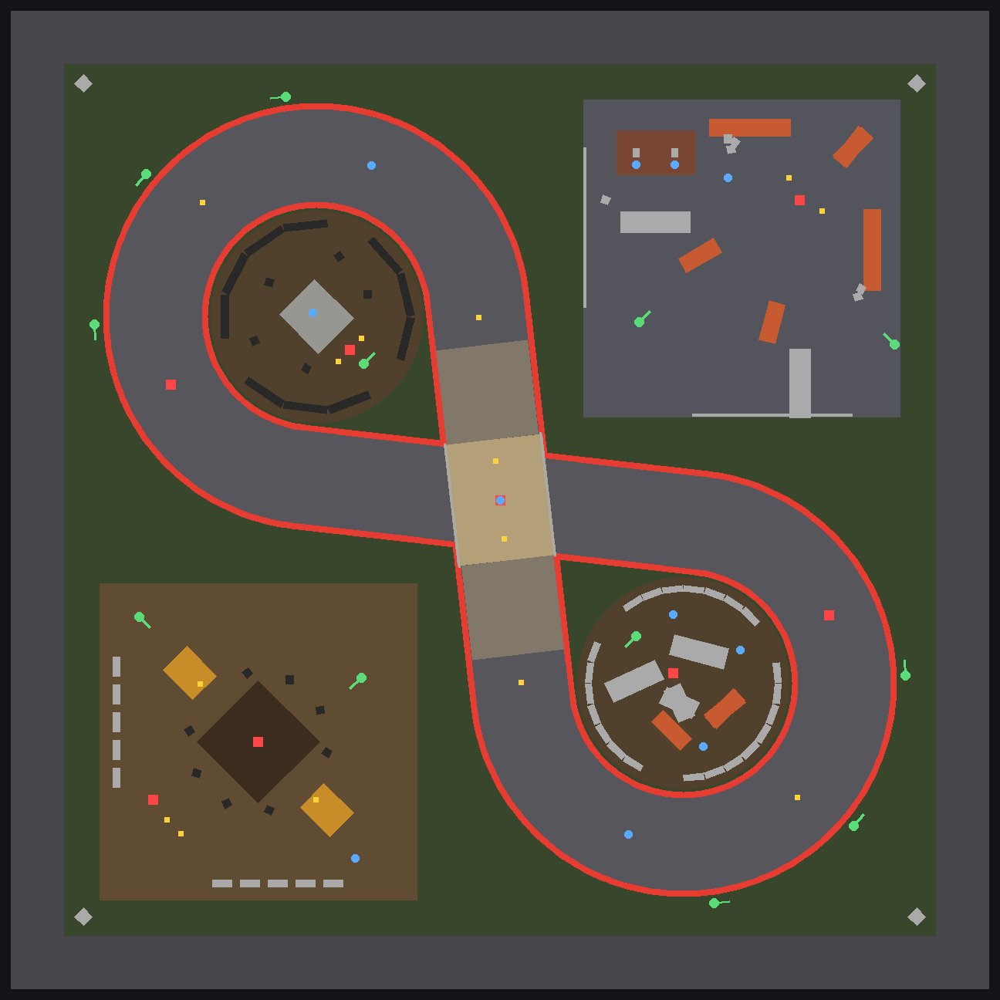

# Figure of 8 (q3r_dd_02)

Stadion mit einer echten Acht für Deathmatch, Team Deathmatch, Derby (neu) und Last Car
Standing. Überarbeitung der Map von P3rlE: Das Stadion bleibt (Tribünen mit Publikum,
Bandenwerbung, Presseturm, das Gerüst mit seinen Lampen, die Skyline), das Spielfeld
ist neu. Erzeugt von `tools/maptools/make_figure8.py`, die Props von
`tools/maptools/make_figure8_models.py` (Python 3 + numpy + Pillow).



## Vorher

Ein flaches Feld (3.136 × 3.136 Units). Die Acht war nur als Dirt-Textur auf den Boden
gemalt. In der Mitte führten vier Rampen auf eine kleine Plattform mit dem
Flammenwerfer, darunter Mega Health. Sonst gab es keine Deckung und keine
Höhenunterschiede, die Railgun beherrschte das ganze Feld. 8 der 12 Startpunkte standen
dicht um die Mitte mit Blick hinein. Raketenwerfer und Shotgun lagen am selben Punkt
übereinander, neben einer Railgun lag Shotgun-Munition. Sehr dunkel, viel Dunst.

## Aufbau

Punktsymmetrisch zur Feldmitte (-32 -32), bis auf die zwei Eckzonen.

- **Die Acht:** Asphalt (`q3r_road/asph03`, Asphalt-Physik), 330 breit, mit rot-weißen
  Curbs (22 breit). Zwei Schleifen (580 bis zur Mittellinie) in Nordwest und Südost,
  dazwischen zwei Geraden, die sich in der Mitte unter 77 Grad kreuzen.
- **Brücke über die Kreuzung:** Die fast nord-südliche Gerade läuft über eine Brücke
  (Deck 112 hoch und 440 lang, Rampen 340 lang mit 17 Grad, gelbes Geländer), die
  ost-westliche darunter durch (90 Durchfahrtshöhe). Oben liegt die Railgun, ganz offen;
  unten Mega Health. Vor jeder Rampe liegt ein Turbo. Die Videoleinwand über der Mitte
  hängt 80 höher, damit Autos auf der Brücke frei sind.
- **Reifenlager** (Insel in der Nordwest-Schleife): ein Ring aus Reifenwänden mit drei
  Einfahrten, in der Mitte eine Betongarage (zur Brücke offen, Health drin), lose
  Reifenstapel, die Minen vor der Garage.
- **Schrottplatz** (Insel in der Südost-Schleife): ein Ring aus Betonbarrieren mit drei
  Einfahrten, Wracks (rostig), Container (einer gestapelt), Smoke und Health.
- **Fahrerlager** (Nordost-Ecke): Asphalt mit Parkmarkierung, zwei Trucks, Container
  (zwei gestapelt), eine Tankstelle mit Dach, zwei Zapfsäulen und Treibstoff,
  Leitplanken zur Strecke, der Raketenwerfer im Winkel der Container, grüne Rüstung.
- **Schlammgrube** (Südwest-Ecke): Schlamm mit einem Tümpel in der Mitte, zwei Kicker
  einander gegenüber über den Tümpel (der Flammenwerfer liegt mittendrin), Reifenstapel,
  Betonbarrieren an den Rändern, Shotgun.
- **Licht:** In jeder Feldecke ein Flutlichtmast mit 12 Strahlern (drei Spots), dazu
  ein Raster schwacher Lampen unter dem Gerüst; die alten Lampen am Gerüstrand halb so
  hell. Licht unter der Brücke, in der Garage und unter dem Tankstellendach. Dunst
  (`haze`) dünner, `autoExposureMinMax -2 1`, damit das helle Feld unter dem dunklen
  Himmel nicht überstrahlt. Der Himmel `mp_us` (nur diese Map nutzt ihn) gibt weniger
  Flächenlicht ab (55 statt 100).

## Props

Alle Props sind Modelle (`misc_model`, von q3map2 eingebacken); jedes bekommt eine
`common/full_clip`-Box, die auch die Bots (AAS) sehen.

| Modell | Herkunft |
|---|---|
| Container 20 ft (rot, blau, grün, orange), 40 ft (rot, blau) | neu, `models/mapobjects/q3r_figure8/` |
| Reifenwand, Reifenstapel (3, 5) | neu |
| Flutlichtmast (460 hoch, Strahler leuchten selbst: `scripts/q3r_figure8.shader`) | neu |
| Betonbarriere, Leitplanke, Zapfsäule, Brückengeländer | neu |
| Trucks (`vehicles/truck_flatbed`, 2,3-fach) | vorhanden |
| Wracks (`vehicles/*_damaged*`, mit `_remap` auf `q3r_metals/rustmet01`) | vorhanden |
| Fässer, Pylonen | vorhanden |

Die neuen Modelle und ihre Texturen (eigene, generiert; Schrift DejaVu Sans) schreibt
`make_figure8_models.py`.

## Items

| Item | Ort |
|---|---|
| Railgun, 2 × Slugs | auf der Brücke |
| Mega Health | unter der Brücke |
| Raketenwerfer, 2 × Raketen, grüne Rüstung, 2 × Treibstoff | Fahrerlager |
| Flammenwerfer, 2 × Flammenmunition (auf den Kickern), Shotgun, 2 × Schrot | Schlammgrube |
| Minen, 2 × Minenmunition, große Health (Garage) | Reifenlager |
| Smoke, große Health, 2 × Health | Schrottplatz |
| 2 × Turbo | vor den Brückenrampen |
| je Schleife Raketen, Heckflamme, Health | auf der Strecke |
| große Health | Schlammgrube |

12 Startpunkte: je drei außen an den Schleifen, je zwei in den Eckzonen, je einer auf
den Inseln, alle entlang der Strecke. Keiner näher als 500 an der Brücke.

## Bauen

```text
python tools/maptools/make_figure8_models.py
python tools/maptools/make_figure8.py
q3map2 -game quake3 -fs_basegame baseq3r -fs_basepath <repo> -meta -custinfoparms -keeplights baseq3r/maps/q3r_dd_02.map
q3map2 -game quake3 -fs_basegame baseq3r -fs_basepath <repo> -vis -saveprt baseq3r/maps/q3r_dd_02.map
q3map2 -game quake3 -fs_basegame baseq3r -fs_basepath <repo> -light -custinfoparms -fast -shade -filter -super 2 -bounce 1 baseq3r/maps/q3r_dd_02.map
bspc -forcesidesvisible -optimize -bsp2aas baseq3r/maps/q3r_dd_02.bsp
```

Das Stadion liest der Generator aus `tools/maptools/src/q3r_dd_02_orig.map` (die alte
Map, mit `tools/maptools/mapparse.py`); alles innerhalb der Banden unterhalb 170 fliegt
raus, auch die alte gemalte Acht. Gebaut mit q3map2 aus NetRadiant Custom 20241217 und
bspc von TTimo.

`validation.json` prüft: kein Startpunkt und kein Pickup in einem Brush (Autobreite),
die ganze Acht auf Fahrhöhe frei (Schleifen, beide Geraden, das Deck), die Höhen der
Brücke. `tests/test_figure8_map.py` baut die Map im Speicher nach und prüft dazu, dass
alles innerhalb der Banden liegt, die Startpunkte Abstand halten und die Modelle in die
Grenzen des Renderers passen.

Höhen: Gras 2, Eckzonen 3 (ohne Gras darunter), Strecke und Curbs 6, Inseln 8. Die
Abstände verhindern, dass sich Flächen im Tiefenpuffer streiten.

## Geprüft im Spiel

- Deathmatch mit 6 Bots: Die AAS lädt, die Bots fahren und kämpfen.
- Derby lädt und startet.
- Mit dem Auto über die Brücke: die Rampe hoch, über das Deck (Slugs, Railgun), die
  andere Rampe runter.
