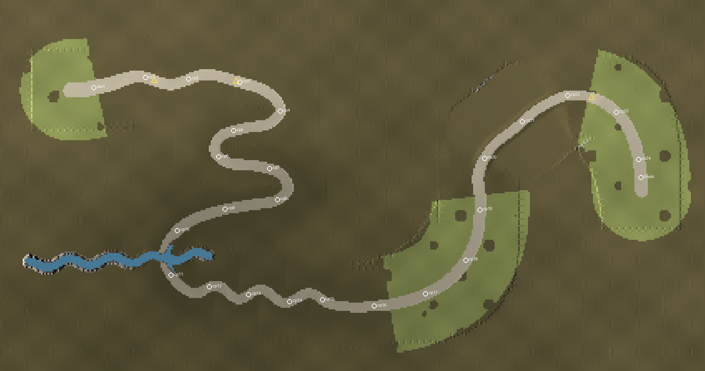

# Timber Run (q3r_timberrun)

Sprint von A nach B auf Schotter durch einen Herbstwald, früh am Morgen. Vom
Holzlagerplatz auf dem Rücken hinunter ins Bachtal und wieder hinauf zur Wiese.
Erzeugt von `tools/maptools/make_timberrun.py`. Konzept: Dokument „Timber Run –
Sprint-Strecke“.

Stand: **Stufe 2** (Wald, Nebel, Licht).



## Strecke

Länge 48.448 Einheiten, geschätzte Fahrzeit 88 Sekunden, Start auf z 1200, Ziel
auf z 1032, tiefster Punkt in der Furt (z 629). Kleinster Kurvenradius 451,
größte Steigung 17 % (Abfahrt der großen Kuppe). Alles Schotter (`SURF_GRAVEL`).

| Abschnitt | Länge | Charakter |
|---|---|---|
| Holzlagerplatz | 1.500 | Start, breit, offen |
| Forststraße | 6.300 | schnell, sanfte Bögen, zwei kleine Sprungkuppen |
| Hangkehren | 9.350 | drei Kehren den Hang hinunter |
| Bachtal und Furt | 6.050 | Gefälle zum Bach, Furt, Gegenanstieg |
| Fichtendickicht | 7.400 | eng (halbe Breite 152), Kurve an Kurve |
| Kahlschlag | 7.750 | breit und offen, lange schnelle Bögen |
| Hohlweg | 4.700 | bergauf zwischen Erdböschungen |
| Kuppe und Wiese | 4.500 | große Sprungkuppe, dann offen bergab |
| Ziel | 900 | Zielbogen auf der Wiese |

- **Sprungkuppen:** Die Auffahrt ist am Fuß ausgerundet, die Kante oben nicht,
  damit die Autos abheben. Klein: 7 % hinauf, 11 % hinunter, 28 hoch. Groß: 10 %
  hinauf, 16 % hinunter, 60 hoch. Sie liegen dort, wo die Straße in der Nähe der
  gewünschten Stelle am geradesten ist.
- **Furt:** Der Bach kreuzt die Straße im rechten Winkel. Das Wasser steht 12
  tief über 416 Einheiten Straße, ohne Quergefälle. Der Boden dort ist
  `SURF_GRAVEL` + `SURF_WET` (immer nasser Grip). Das Wasser ist eine ebene,
  nicht solide Fläche; der Boden liegt überall sonst darüber.
- **Hohlweg:** Böschungen bis 150 hoch auf beiden Seiten, egal wie das Gelände
  liegt.
- **Grenzen:** unsichtbare Wände auf beiden Seiten, 130 hinter dem Bankett, und
  quer an beiden Enden. Zwischen den Kehren rücken sie zusammen.
- **Checkpoints:** 24, vom Generator so gesetzt, dass die Bot-Route (`.bpd`,
  eine Bézier-Kurve je Abschnitt) höchstens 64 Einheiten von der Mittellinie
  abweicht und nie mehr als 2.048 Einheiten zwischen zwei Checkpoints liegen.
- **Wetter:** Regen, 40 %. Kein Schnee.

## Wald, Nebel, Licht (Stufe 2)

- **Bäume nah an der Straße:** 714 echte Modelle bis 480 Einheiten hinter dem
  Fahrbahnrand: Fichten (`GR_trees/nadelbaum`, ×3,0–4,4, also 430–630 hoch),
  Buchen in Gelb, Rot und Grün (`GR_trees/tree1/3/4`, ×2,0–2,8), Eichen
  (`oak/oak2`) im Hohlweg und auf der Wiese, junge Fichten und tote Stämme im
  Kahlschlag. Die Blätter laufen über eigene Shader
  (`models/mapobjects/q3r_timberrun/`) mit umgefärbten Texturen und
  `alphashadow`, die Bäume werfen Schatten (`_cs 1`).
- **Mischung je Abschnitt:** Forststraße Fichte mit Buchen, Hangkehren vor allem
  Buchen, Bachtal grüne und gelbe Buchen, Dickicht fast nur Fichte (dicht),
  Kahlschlag und Wiese licht, Hohlweg Buchen und Eichen.
- **Innerhalb der Wände** stehen Bäume nur an geraden Stücken, nie außen in
  einer Kurve (72 Stück). Stämme bis 400 hinter dem Rand haben einen
  unsichtbaren, festen Kern (549).
- **Weiter draußen:** 3066 gekreuzte Flächen mit gerenderten Seitenansichten
  derselben Modelle (`cross_*.md3`, je 4 Dreiecke), bis 2700 hinter dem Rand.
- **Boden:** eigene Waldboden-Textur mit Laub, Nadeln und Moos.
- **Himmel:** eigener Morgenhimmel (`env/q3r_timberrun/`), Sonne bei 300° und
  20° Höhe, also tief im Südosten; `q3map_sun` und `q3gl2_sun` stehen gleich.
- **Nebel:** `q3r_haze` nimmt nach 3000 Einheiten die Hälfte der Sicht, dazu
  Bodennebel im Bachtal (halbe Sicht nach 1300, über dem Wasser am dichtesten).
- **Sichtweite:** `_farplanedist 7000`: vis wirft weg, was mehr als etwa 9400
  entfernt liegt. Dort ist im Nebel kaum noch etwas übrig.

### Bildrate

Gemessen mit `r_speeds 1` und `com_speeds 1` in der Linux-Engine (Software-
Renderer, also nur als Vergleich brauchbar), an neun Stellen der Strecke, Kamera
150 über der Straße. Zum Vergleich Riviera Run an fünf Stellen.

| | Dreiecke | Flächen | Zeit je Bild |
|---|---|---|---|
| Timber Run, ohne Fernsicht-Grenze, 1132 Modelle | bis 651.000 | bis 21.600 | 224–557 ms |
| Timber Run, wie ausgeliefert | bis 336.000 | bis 12.400 | 221–497 ms |
| Riviera Run | bis 520.000 | bis 31.200 | 257–354 ms |

Am teuersten ist der Blick über die Hangkehren (viele Blätter übereinander). Auf
einer echten Grafikkarte ist das kein Problem; im Spieltest mit `cg_drawFPS 1`
die Kehren und den Blick von der ersten Kuppe ansehen.

## Geprüft

- **Kompilieren:** kein Leck; BSP 12,7 MB. Gelände aus 33.220 Dreiecken.
- **AAS:** aus der Ersatzkarte gebaut (`docs/maps/aas_proxy.md`), 37.190 Areas,
  lädt ohne Fehler. bspc braucht dafür vier Minuten.
- **Bots, Sprint (`g_gametype 7`), 4 Bots, Stufe 4, ein Lauf:** Alle nutzen die
  BPD-Route (`G_RaceRoute: source=bpd`, 24 von 24 Griffen). Drei kamen ins Ziel,
  nach 111, 113 und 122 Sekunden; der vierte (Mini) war beim Rennende noch
  unterwegs.
- **Bilder:** alle Abschnitte in der Linux-Engine angesehen (Start, Kuppen,
  Kehren, Furt, Dickicht, Kahlschlag, Hohlweg, Ziel).

Noch offen für den Spieltest mit Menschen: Fahrzeit, Sprungweite der Kuppen,
Breite im Dickicht.

## Stufen

1. **Fahrbarer Rohbau:** Gelände, Fahrbahn, Kuppen, Furt, Grenzen, Start, Ziel,
   Checkpoints, Bot-Route, AAS, Kurvenschilder.
2. **Wald, Nebel, Licht** (dieser Stand), Prüfung der Bildrate.
3. Details, Sound, Wetter, Levelshot.

## Bauen

```text
python tools/maptools/make_timberrun.py
q3map2 -game quake3 -fs_basegame baseq3r -fs_basepath <repo> -meta -custinfoparms <map>
q3map2 -game quake3 -fs_basegame baseq3r -fs_basepath <repo> -vis -saveprt <map>
q3map2 -game quake3 -fs_basegame baseq3r -fs_basepath <repo> -light -custinfoparms -fast -shade -filter -super 2 -bounce 1 <map>
bspc -forcesidesvisible -optimize -bsp2aas <bsp>
```

Der Generator schreibt die Map, `maps/q3r_timberrun_index.pcx` (Bodenschichten),
`maps/q3r_timberrun.bpd`, `scripts/q3r_timberrun.shader` und `.arena`, die
Kamerafahrt in `intro_routes/`, die Texturen in `textures/q3r_timberrun/` sowie
`timberrun_layout.png` und `validation.json` hier. `shaderlist.txt` muss
`q3r_timberrun` enthalten.

Die AAS entsteht aus der Ersatzkarte:

```text
python tools/maptools/make_aas_proxy.py baseq3r/maps/q3r_timberrun.map
q3map2 -game quake3 -fs_basegame baseq3r -fs_basepath <repo> -bsp -custinfoparms baseq3r/maps/q3r_timberrun_aasproxy.map
bspc -forcesidesvisible -optimize -bsp2aas baseq3r/maps/q3r_timberrun_aasproxy.bsp
python tools/maptools/make_aas_proxy.py --checksum baseq3r/maps/q3r_timberrun_aasproxy.aas baseq3r/maps/q3r_timberrun.bsp
```

Der Generator schreibt außerdem den Himmel nach `env/q3r_timberrun/` und die
Baumtexturen, Sprites und `cross_*.md3` nach `models/mapobjects/q3r_timberrun/`.
Die Lichtberechnung braucht wegen der Schatten der Blätter rund 35 Minuten.
